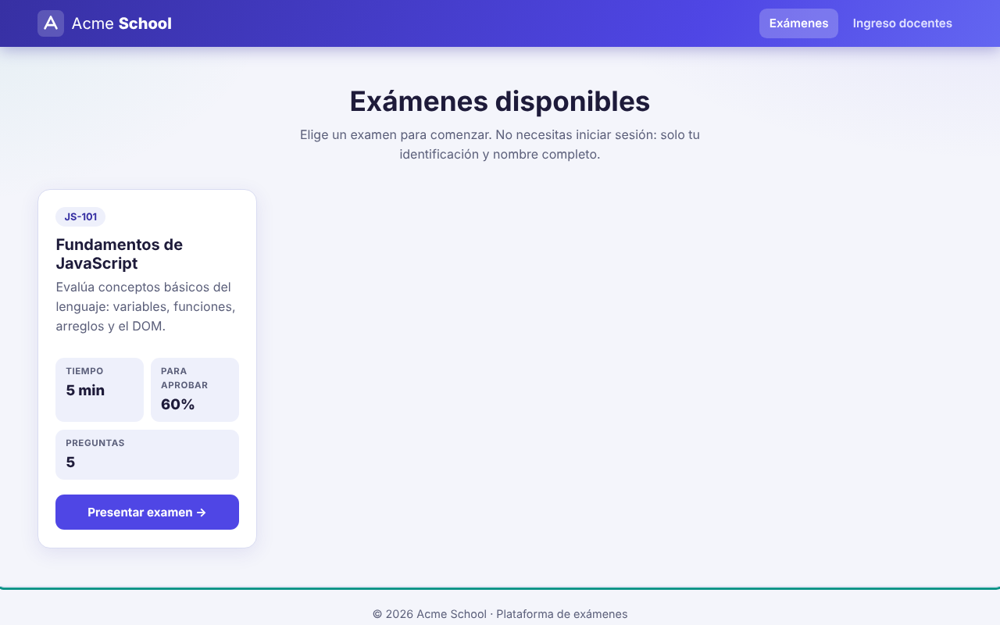
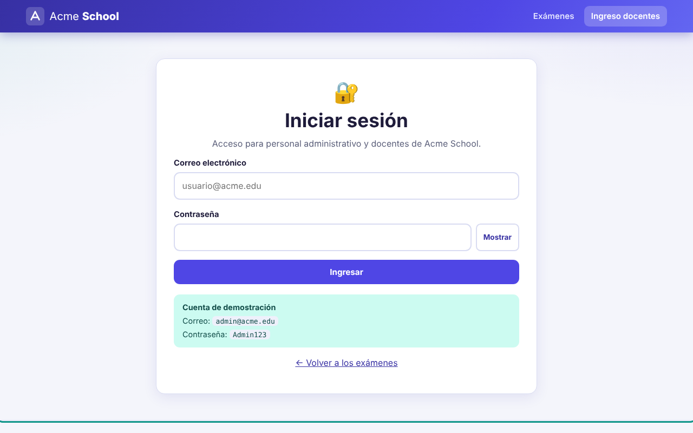
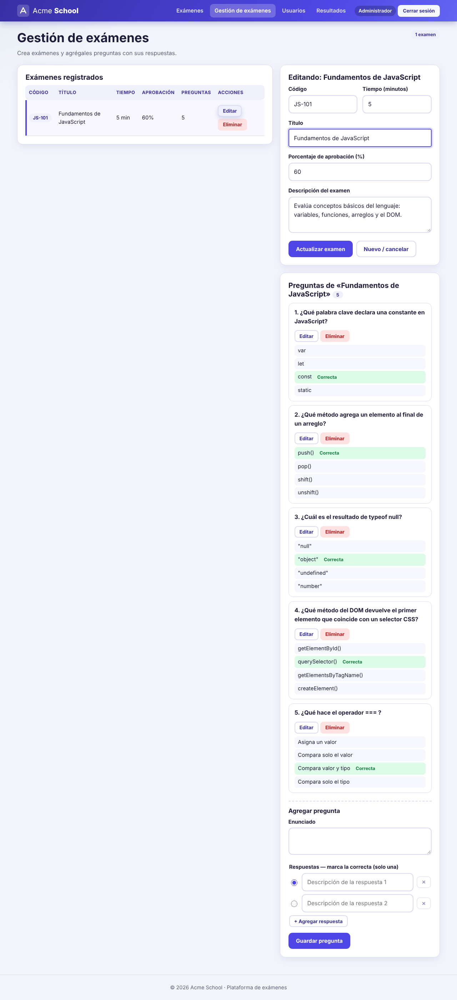
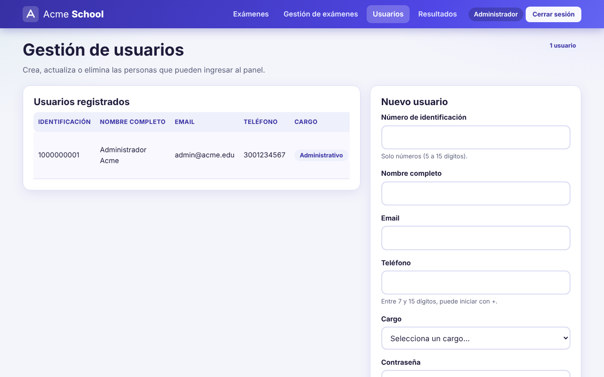
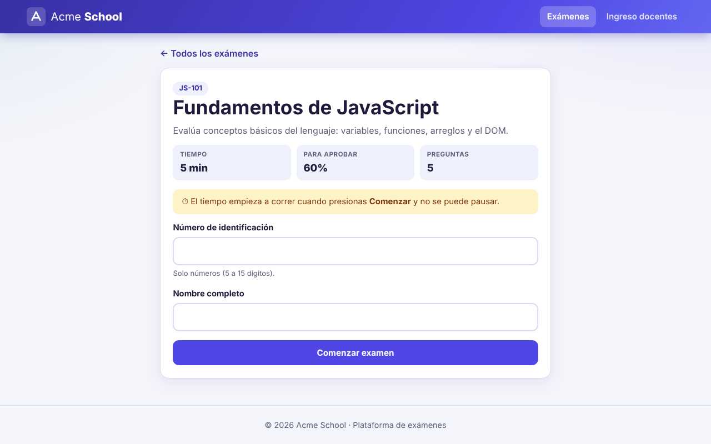
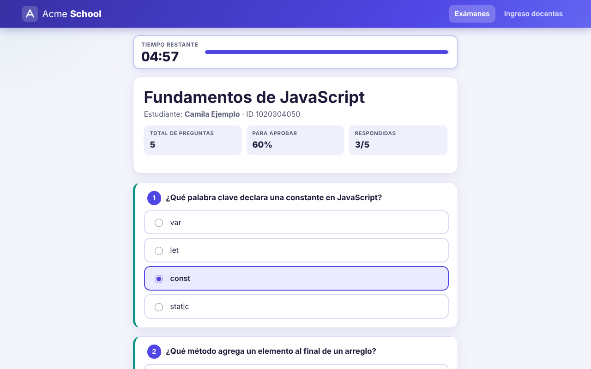
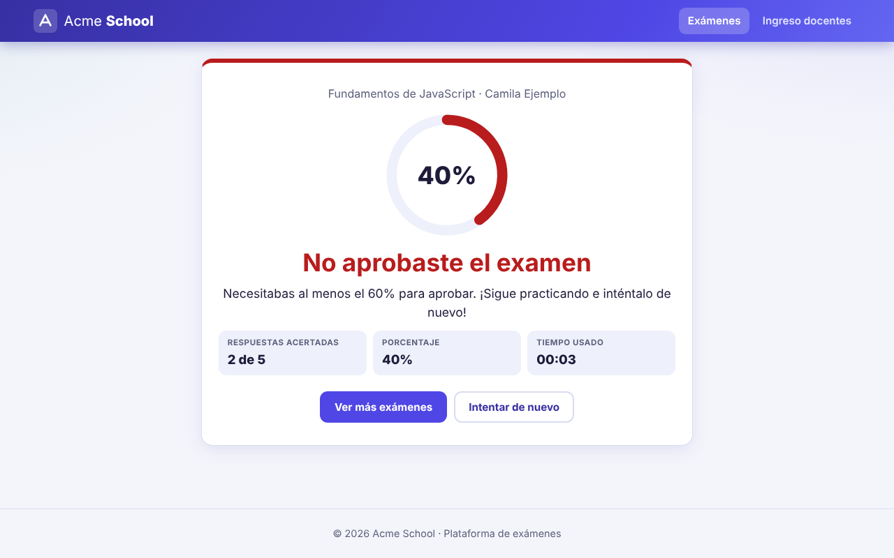
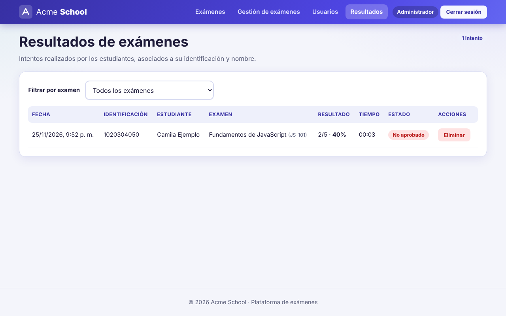
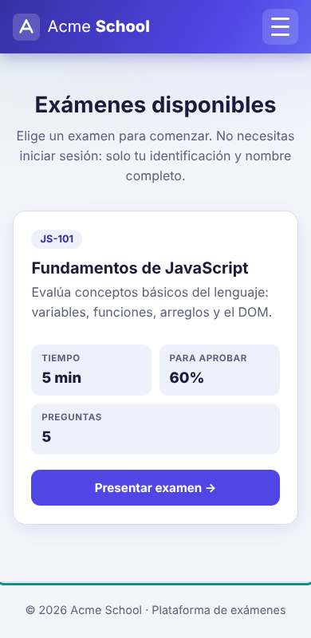

# Acme School - Plataforma de Exámenes en Línea

Aplicación web de una sola página (SPA) desarrollada con **HTML5 semántico**, **CSS3 moderno (Grid y Flexbox)** y **JavaScript Vanilla (ES6+ con módulos)** puro, sin frameworks ni librerías externas. Permite que el personal de la escuela **Acme** cree y administre exámenes, y que los estudiantes los resuelvan por la web con control de tiempo en tiempo real. Toda la información se persiste en el navegador mediante **localStorage** con estructuras **JSON**, y la interfaz se construye con **Web Components** (Custom Elements + Shadow DOM).

---

## 1. Descripción del Proyecto

**Acme School** es una plataforma con dos caras:

- **Zona pública (estudiantes):** listado de exámenes disponibles, identificación del estudiante, resolución con temporizador y resultado inmediato. No requiere iniciar sesión.
- **Zona privada (administrativos y docentes):** login, gestión de usuarios (CRUD), gestión de exámenes con sus preguntas y respuestas (CRUD) y consulta de resultados. Solo es accesible con una sesión activa.

### Cómo ejecutarlo

Los módulos ES (`import`/`export`) **no se cargan al abrir `index.html` con doble clic (`file://`)**: el navegador los bloquea y la página queda en blanco. Hay que servir la carpeta con un servidor estático:

```bash
# Opción 1: Live Server (VS Code) -> clic derecho en index.html -> "Open with Live Server"
# Opción 2: Python
python3 -m http.server 8080
# Opción 3: Node
npx serve .
```

Luego abrir `http://localhost:8080`.

**Cuenta de demostración** (se crea automáticamente en el primer arranque):

| Correo | Contraseña |
| :--- | :--- |
| `admin@acme.edu` | `Admin123` |

También se crea un examen de ejemplo (`JS-101 · Fundamentos de JavaScript`, 5 preguntas, 5 minutos, 60 % para aprobar).

---

## 2. Módulos y Arquitectura del Sitio

La navegación usa un **router propio basado en hash** (`#/ruta`), de modo que no necesita servidor con reglas de reescritura y cada vista es un Web Component que el router monta en `<main>`.

| Módulo | Ruta | Acceso | Componente |
| :--- | :--- | :--- | :--- |
| Lista de exámenes disponibles | `#/` | Público | `<exam-list-view>` |
| Resolución de examen | `#/examen/:id` | Público | `<exam-taker-view>` |
| Login | `#/login` | Público (redirige si ya hay sesión) | `<login-view>` |
| Gestión de usuarios (CRUD) | `#/admin/usuarios` | Privado | `<users-view>` |
| Gestión de exámenes y preguntas (CRUD) | `#/admin/examenes` | Privado | `<exams-view>` |
| Resultados de los estudiantes | `#/admin/resultados` | Privado | `<results-view>` |

Las rutas privadas están protegidas por el router: si no hay sesión redirige a `#/login`, guarda la ruta pedida en `sessionStorage` y, tras ingresar, devuelve al usuario a ella. Si se visita una ruta inexistente se muestra una página 404 amigable.

### Funcionalidad por módulo

- **Login:** correo y contraseña, botón para mostrar/ocultar la contraseña, mensaje de error genérico (no revela si el correo existe) y cuenta de demostración visible.
- **Gestión de usuarios:** tabla con los usuarios registrados, formulario de creación/actualización y botones *Editar* y *Eliminar* por fila. Campos: identificación, nombre completo, email, teléfono, cargo (Administrativo / Docente) y contraseña. Al editar, dejar la contraseña vacía conserva la actual.
- **Gestión de exámenes:** tabla de exámenes, formulario (código, título, tiempo en minutos, porcentaje de aprobación, descripción) y, al crear o editar un examen, un panel para administrar sus **preguntas**. Cada pregunta tiene de 2 a 6 respuestas con descripción y **exactamente una marcada como correcta**.
- **Resolución de exámenes:**
  1. Lista con título, tiempo y porcentaje de aprobación de cada examen.
  2. Solicitud de número de identificación y nombre completo (a los que queda asociado el intento).
  3. Encabezado con título, total de preguntas y porcentaje para aprobar; preguntas numeradas con selección única; reloj regresivo en tiempo real.
  4. Botón **Terminar examen** (advierte si hay preguntas sin responder) y envío automático si el tiempo llega a 0.
  5. Resultado con porcentaje de aciertos y mensaje de aprobado / no aprobado según el porcentaje configurado en el examen.
- **Resultados:** tabla con todos los intentos (estudiante, examen, aciertos, porcentaje, tiempo usado, estado), filtro por examen y eliminación de intentos.

---

## 3. Justificación de Etiquetas Semánticas y Accesibilidad

- **`<header>` y `<nav aria-label="Principal">`:** encabezado institucional (`<acme-header>`) con la navegación. El enlace activo se marca con `aria-current="page"`; los enlaces privados solo se renderizan con sesión activa.
- **`<main id="view" tabindex="-1">`:** contenedor único del contenido de cada vista. Tras cada cambio de ruta el router le asigna el foco para que lectores de pantalla y teclado no queden "perdidos".
- **`<section>`, `<article>`:** cada vista es una `<section class="page">`; cada examen de la lista es un `<article class="card">` independiente.
- **`<form>`, `<label for>`, `<fieldset>` y `<legend>`:** todos los campos tienen etiqueta asociada; cada pregunta del examen es un `<fieldset>` con su enunciado en `<legend>`, lo que anuncia correctamente el grupo de opciones.
- **`<table>` con `<caption>`, `<th scope>`:** las tablas (`<acme-data-table>`) tienen título oculto visualmente (`.sr-only`) y encabezados con alcance.
- **`<dl>`:** datos como tiempo, porcentaje y número de preguntas se marcan como lista de definición.
- **`<dialog>` nativo:** los diálogos de confirmación atrapan el foco, se cierran con `Esc` y devuelven el foco al elemento anterior.
- **Regiones `aria-live` / `role="alert"` / `role="timer"`:** errores de formulario, notificaciones y reloj. El reloj **no** anuncia cada segundo: solo avisa en los hitos de 5 min, 1 min, 30 s y 10 s.
- **Otros:** enlace *"Saltar al contenido"*, foco visible de alto contraste, navegación completa con teclado, `prefers-reduced-motion` respetado y `<noscript>` informativo.
- **`<footer>`:** créditos del proyecto.

---

## 4. Identidad Visual y Variables CSS (`:root`)

Paleta basada en un índigo institucional con acento turquesa, superficies claras y colores semánticos de alto contraste para estados:

| Variable | Valor | Aplicación |
| :--- | :--- | :--- |
| `--primary` | `#4f46e5` | Botones principales, selección activa, números de pregunta |
| `--primary-dark` | `#3730a3` | Encabezado (degradado), enlaces, hover de botones |
| `--primary-soft` | `#eef0fb` | Fondos suaves de tarjetas de datos, cabeceras de tabla |
| `--accent` | `#0d9488` | Foco visible, indicador de pregunta respondida |
| `--bg` | `#f4f5fb` | Fondo general de la aplicación |
| `--surface` | `#ffffff` | Tarjetas y formularios |
| `--text` | `#1e1b3a` | Texto principal |
| `--muted` | `#5b5f7a` | Textos secundarios y ayudas |
| `--success` | `#15803d` | Examen aprobado, respuesta correcta |
| `--danger` | `#b91c1c` | Errores, eliminación, examen no aprobado |
| `--warning` | `#b45309` | Reloj con poco tiempo restante |

Las **animaciones y transiciones** (todas desactivables con `prefers-reduced-motion`): aparición suave de vistas, elevación de tarjetas y botones al pasar el cursor, barra de progreso del reloj, anillo animado del resultado, notificaciones que entran y salen, y diálogos con efecto *pop*.

---

## 5. Arquitectura CSS y Diseño Responsivo

Los estilos se centralizan en **`css/styles.css`**:

1. **Reset y variables globales:** `box-sizing: border-box`, tipografía del sistema y tokens en `:root`.
2. **CSS Grid:** la lista de exámenes usa `repeat(auto-fill, minmax(17rem, 1fr))` y los módulos CRUD usan una cuadrícula de dos columnas (tabla + formulario) que pasa a una columna en pantallas menores a 62 rem.
3. **Flexbox:** tarjetas, barras de acciones, filas de respuestas y encabezados.
4. **Tablas que se vuelven tarjetas en móvil:** por debajo de 46 rem cada fila se muestra como una tarjeta usando `data-label` y `::before`, sin scroll horizontal.
5. **Menú plegable** con botón hamburguesa (`aria-expanded`) en pantallas pequeñas.
6. **Reloj fijo (`position: sticky`)** durante el examen, para que el estudiante siempre vea el tiempo restante.

---

## 6. Lógica JavaScript

El código está modularizado en capas (ES Modules):

- **`storage.js`:** capa de persistencia con `localStorage` (datos permanentes) y `sessionStorage` (progreso temporal del examen), con prefijo `acme:`, `JSON.parse` protegido con `try/catch` y error claro si el almacenamiento está lleno.
- **`services/`:** lógica de negocio y reglas de validación, independiente de la interfaz (`users`, `auth`, `exams`, `attempts`, `seed`).
- **`components/`:** Web Components reutilizables, descritos abajo.
- **`views/`:** una vista por módulo; cada una es un Custom Element que renderiza su plantilla y conecta sus eventos.
- **`router.js`:** enrutamiento por hash, parámetros de ruta y guardas de acceso.

### Web Components creados

| Componente | Descripción |
| :--- | :--- |
| `<acme-header>` | Barra de navegación que cambia según la sesión y marca la página activa. |
| `<acme-data-table>` | Tabla accesible y reutilizable: recibe `columns`, `rows` y `actions`, y emite el evento `row-action`. Se usa en usuarios, exámenes y resultados. |
| `<acme-timer>` | Cuenta regresiva (Shadow DOM) con barra de progreso, cambio de color según el tiempo restante y eventos `timer-tick` y `timer-end`. |
| `<acme-confirm>` | Diálogo modal de confirmación (Shadow DOM) basado en `<dialog>`; se usa con `await confirmDialog({...})`. |
| `<acme-toast>` | Notificaciones temporales (Shadow DOM) con `aria-live`. |
| `*-view` | Las seis vistas de la aplicación, también como Custom Elements. |

### Reglas de negocio y validaciones

- Identificación de 5 a 15 dígitos; teléfono de 7 a 15 dígitos; email válido; **email e identificación únicos**.
- No se puede eliminar la propia cuenta ni al último usuario administrativo.
- Código de examen único; tiempo entero entre 1 y 300 minutos; aprobación entre 1 y 100 %.
- Cada pregunta: enunciado obligatorio, entre 2 y 6 respuestas, sin respuestas repetidas y **exactamente una correcta**.
- Un examen sin preguntas no se puede presentar (aparece deshabilitado en la lista).
- Las contraseñas se guardan como hash **SHA-256** (Web Crypto) y el login muestra un mensaje genérico ante credenciales inválidas.

---

## 7. Estructura de Datos (JSON en localStorage)

```jsonc
// acme:users
[{ "id": "uuid", "identificacion": "1000000001", "nombre": "Administrador Acme",
   "email": "admin@acme.edu", "telefono": "3001234567",
   "cargo": "Administrativo", "passwordHash": "sha256...", "creadoEn": "ISO-8601" }]

// acme:exams
[{ "id": "uuid", "codigo": "JS-101", "titulo": "Fundamentos de JavaScript",
   "tiempo": 5, "aprobacion": 60, "descripcion": "...",
   "preguntas": [{ "id": "uuid", "texto": "...",
     "respuestas": [{ "id": "uuid", "texto": "...", "correcta": true }] }] }]

// acme:attempts  (un registro por examen presentado)
[{ "id": "uuid", "examenId": "uuid", "examenCodigo": "JS-101", "examenTitulo": "...",
   "identificacion": "1020304050", "nombre": "Camila Ejemplo",
   "respuestas": { "<preguntaId>": "<respuestaId>" },
   "preguntas": 5, "aciertos": 4, "porcentaje": 80, "aprobado": true,
   "tiempoUsado": 123, "terminadoPor": "usuario | tiempo", "fecha": "ISO-8601" }]

// acme:session  -> { "userId": "uuid", "desde": "ISO-8601" }
```

El intento guarda una copia del código y título del examen, de modo que el historial se conserva aunque el examen se edite o elimine. Para reiniciar los datos de prueba basta con borrar las claves `acme:*` en *DevTools → Application → Local Storage*.

---

## Dificultades Técnicas y Soluciones Implementadas

### 1. Pantalla en blanco al abrir el proyecto con doble clic
- **Problema:** al abrir `index.html` directamente desde el explorador de archivos solo aparecía el pie de página; el encabezado y el contenido no se renderizaban.
- **Causa:** el navegador bloquea los módulos ES (`<script type="module">`) bajo el protocolo `file://` por política CORS, así que ningún Web Component llegaba a registrarse.
- **Solución:** servir el proyecto desde un servidor local (Live Server, `python -m http.server` o `npx serve`) y documentarlo de forma destacada al inicio de este README.

### 2. Temporizador impreciso y que se reiniciaba al recargar
- **Problema:** un contador que resta 1 segundo por cada `setInterval` se desfasa cuando la pestaña queda en segundo plano (el navegador reduce la frecuencia de los timers) y, además, al recargar el examen el tiempo volvía a empezar, lo que permitía "reiniciar" el reloj.
- **Causa:** el tiempo restante dependía de cuántos ticks se habían ejecutado, no del tiempo real transcurrido.
- **Solución:** al iniciar el examen se calcula una **hora límite absoluta** (`deadline = Date.now() + minutos × 60000`) y el reloj, en cada tick (250 ms), muestra `deadline − Date.now()`. La hora límite, los datos del estudiante y las respuestas se guardan en `sessionStorage`; al recargar se restauran sin reiniciar el tiempo, y si la hora límite ya pasó el examen se envía automáticamente.

### 3. Garantizar una única respuesta correcta sin perder lo escrito
- **Problema:** el formulario de preguntas permite agregar y quitar respuestas dinámicamente. Al volver a renderizarlo se perdía el texto ya escrito, y quitar justo la respuesta marcada como correcta dejaba la pregunta sin ninguna correcta.
- **Causa:** el formulario se regenera con `innerHTML`, que descarta el estado de los inputs.
- **Solución:** se mantiene un **borrador** (`#draft`) sincronizado con el DOM antes de cada re-render (`#syncDraft`), se usan *radio buttons* con un mismo `name` (la selección única queda garantizada por la interfaz) y, si se elimina la respuesta correcta, la primera pasa a ser la correcta. Además el servicio `exams.js` revalida que haya entre 2 y 6 respuestas, sin repetidas y con exactamente una correcta, para no confiar solo en el frontend.

### 4. «Intentar de nuevo» no recargaba el examen
- **Problema:** al terminar un examen, el botón *Intentar de nuevo* apuntaba a la misma ruta y no pasaba nada.
- **Causa:** cambiar a un hash idéntico al actual no dispara el evento `hashchange`, por lo que el router no volvía a montar la vista.
- **Solución:** el botón intercepta el clic y reemplaza el elemento `<exam-taker-view>` por una instancia nueva con los mismos parámetros de ruta.

### 5. Envío doble o conflictos al terminar el examen
- **Problema:** si el tiempo se agotaba mientras el estudiante tenía abierto el diálogo de confirmación de *Terminar*, podían ejecutarse dos envíos (o quedar el diálogo encima del resultado).
- **Causa:** dos orígenes del evento de cierre (clic del usuario y `timer-end`) corrían de forma independiente.
- **Solución:** un indicador `#finished` hace que la finalización sea idempotente (se guarda un único intento), y al finalizar se elimina cualquier `<acme-confirm>` abierto. El resultado indica si el examen se envió automáticamente por tiempo.

### 6. Inyección de código (XSS) al renderizar datos con `innerHTML`
- **Problema:** títulos, nombres y respuestas escritos por los usuarios se insertan en plantillas HTML; un valor como `` podría ejecutarse.
- **Causa:** las plantillas con `innerHTML` interpretan el texto como marcado.
- **Solución:** una función `esc()` escapa `& < > " '` en **todo** dato dinámico antes de insertarlo; en los componentes con Shadow DOM (notificaciones, diálogos) se usa `textContent`. El router también escapa la ruta mostrada en la página 404.

### 7. Tablas de datos ilegibles en pantallas pequeñas
- **Problema:** las tablas con 6 o 7 columnas obligaban a hacer scroll horizontal en móvil y la columna de acciones quedaba cortada.
- **Causa:** el ancho mínimo del contenido de la tabla superaba el del contenedor.
- **Solución:** `<acme-data-table>` agrega `data-label` a cada celda y, en pantallas pequeñas, el CSS convierte cada fila en una tarjeta que muestra la etiqueta de cada columna con `::before`. En escritorio los botones de acción pueden envolverse en varias líneas para no desbordar.

### 8. Cuenta de administrador inicial sin romper la seguridad de la aplicación
- **Problema:** al ser una aplicación con login pero sin servidor ni usuarios previos, el primer arranque no tenía forma de ingresar.
- **Causa:** los módulos privados exigen sesión, pero la sesión requiere un usuario ya existente.
- **Solución:** un servicio `seed.js` crea, solo si no hay usuarios, un administrador de demostración y un examen de ejemplo. Además, el sistema impide eliminar al último usuario administrativo para que nunca se pierda el acceso al panel.

---

## Evidencias y Pantallazos del Proyecto

A continuación se documentan las vistas principales de la aplicación en funcionamiento.

1. **Lista de exámenes disponibles (público):** título, tiempo y porcentaje de aprobación de cada examen.

   

2. **Login:**

   

3. **Gestión de exámenes (privado):** tabla, formulario y panel de preguntas con su respuesta correcta marcada.

   

4. **Gestión de usuarios (privado):** tabla y formulario de creación/actualización.

   

5. **Identificación del estudiante antes de comenzar:**

   

6. **Resolución del examen:** encabezado, preguntas numeradas, selección única y reloj en tiempo real.

   

7. **Resultado:** porcentaje de aciertos y mensaje de aprobación según el porcentaje configurado.

   

8. **Resultados de los estudiantes (privado):**

   

9. **Diseño responsive (móvil):**

   

---

## 8. Estructura de Archivos del Repositorio

```text
ProyectoAcmeschool_JavaScript_ApellidoNombre/
├── index.html                 # Documento base: header, <main> y script principal
├── README.md                  # Documentación técnica completa
├── css/
│   └── styles.css             # Variables :root, estilos globales, Grid/Flex, animaciones
├── img/                       # Capturas de evidencia (01 a 09)
└── js/
    ├── main.js                # Punto de entrada: datos iniciales + router
    ├── router.js              # Router por hash con rutas privadas
    ├── storage.js             # Capa de persistencia (localStorage / sessionStorage)
    ├── utils.js               # Escape HTML, hash, formato de fecha y hora
    ├── services/              # Lógica de negocio y datos
    │   ├── users.js
    │   ├── auth.js
    │   ├── exams.js
    │   ├── attempts.js
    │   └── seed.js
    ├── components/            # Web Components reutilizables
    │   ├── index.js           # Registro de todos los componentes
    │   ├── acme-header.js
    │   ├── acme-data-table.js
    │   ├── acme-timer.js
    │   ├── acme-confirm.js
    │   ├── acme-toast.js
    │   └── acme-view.js       # Clase base de las vistas
    └── views/                 # Una vista = un Web Component
        ├── login-view.js
        ├── users-view.js
        ├── exams-view.js
        ├── exam-list-view.js
        ├── exam-taker-view.js
        └── results-view.js
```

---

## 9. Consideraciones Finales

- **Seguridad:** al ser una aplicación 100 % cliente, el login y el hash de contraseñas son demostrativos. En un entorno real, la autenticación y la validación de respuestas deben hacerse en un servidor.
- **Persistencia:** los datos viven en el navegador donde se usan; no se comparten entre equipos.
- **Entrega:** repositorio privado en GitHub llamado `ProyectoAcmeschool_JavaScript_ApellidoNombre` (reemplazar *ApellidoNombre* por el del estudiante).
